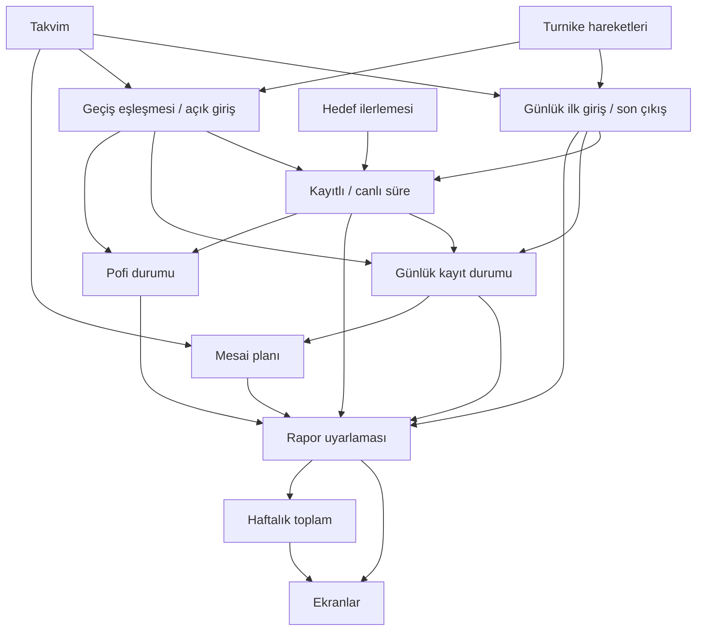

# Ürün kuralları

Her kuralın bir kod sahibi vardır. Görünümler, route'lar ve depolama adaptörleri bu sahiplerin arayüzlerini kullanır. Bu sayfalar sahipliği, sözleşmeyi ve değişiklik etkisini açıklar; çalıştırılan kurallar koddan gelir. Her formül ve ayar kendi sahibinde yönetilir.

[Terimler](../../GLOSSARY.md) · [Ürün](../../PRODUCT.md) · [Doğrulama rehberi](../verification.md)

## Sahip haritası

| Kural                                              | Kod sahibi                                                          |
| -------------------------------------------------- | ------------------------------------------------------------------- |
| [Takvim ve kaynak saati](calendar.md)              | [calendar.ts](../../src/domain/rules/calendar.ts)                   |
| [Turnikeden günlük özet ve kayıtlı süre](recorded-time.md) | [recorded-time.js](../../src/domain/rules/recorded-time.js)         |
| [Turnike geçişleri](passages.md)                   | [passages.js](../../src/domain/rules/passages.js)                   |
| [Günlük kayıt durumu](record-status.md)            | [record-status.ts](../../src/domain/rules/record-status.ts)         |
| [Anlık tahmin ve süre bölümleri](duration.md)      | [duration.js](../../src/domain/rules/duration.js)                   |
| [Hedef ilerlemesi ve grafik ölçeği](progress.md)   | [progress.js](../../src/domain/rules/progress.js)                   |
| [Mesai planı ve çıkış hedefi](work-plan.md)        | [work-plan.ts](../../src/domain/rules/work-plan.ts)                 |
| [Görünen haftalık toplam](week.md)                 | [week.ts](../../src/domain/rules/week.ts)                           |
| [Pofi durum seçimi](pofi.md)                       | [pofi.js](../../src/domain/rules/pofi.js)                           |
| [Not defteri takvimi](notebook-calendar.md)        | [notebook-calendar.ts](../../src/domain/rules/notebook-calendar.ts) |
| [Pofi sürprizleri](pofi-surprises.md)              | [pofi-surprises.ts](../../src/domain/rules/pofi-surprises.ts)       |
| [Oturum politikası](session-policy.md)             | [session-policy.ts](../../src/domain/rules/session-policy.ts)       |
| [Kendi raporu ve tarih aralığı](report-access.md)  | [report-access.ts](../../src/domain/rules/report-access.ts)         |
| [PDKS erişimi ve HTTP sınırları](source-policy.md) | [source-policy.ts](../../src/domain/rules/source-policy.ts)         |

## Hesap bağımlılıkları

Oklar bir kuralın sonucunun nerede kullanıldığını gösterir. Rapor uyarlaması DTO'yu görünüme çevirir; tahmin formülünü veya plan dengelemesini yeniden yazmaz. UI renkleri ve yerleşimi [DESIGN](../../DESIGN.md) belgesinde, bileşen sorumlulukları [arayüz sahiplerinde](../architecture/ui-components.md) yönetilir.

## Diğer tek sahipler

| Alan | Sahip ve görev |
| --- | --- |
| Rapor hazırlığı ve saat izdüşümü | [report.ts](../../src/domain/report.ts): kaynak ve planı ekran modeline uyarlar; hesapları ilgili kurallardan alır |
| Pofi notları | [İçerik yönetim rehberi](../pofi-notes.md): katalog, tek havuz ve seçim motorunun sahipleri; [kaynak adaptörü](../../src/server/pdks.js) hesap anahtarını üretir; [sunucu](../../src/server/pofi-notes.js) not seçimine bağlar |
| Plan kalıcılığı | [plan-storage](../../src/lib/plan-storage.js) serileştirme ve doğrulama; [work-plans](../../src/data/work-plans.ts) canlı/demo depolama kapsamı; [use-work-plans](../../src/data/use-work-plans.ts) başarılı yazıdan sonra durum güncelleme |
| Tema | [theme](../../src/lib/theme.js) tercih değerleri ve `pofis:theme:v1` depolama anahtarı; [use-appearance](../../src/data/use-appearance.ts) işletim sistemi ve depolama olayları |
| Metin ve marka | [ui-text](../../src/lib/ui-text.js), [ton rehberi](../brand/pofi-tone-guide.md) ve [görsel kaynaklar](../brand/assets.md) |
| Kaynak tazeliği ve istek yaşamı | [use-pdks](../../src/data/use-pdks.ts): başarısız yenilemede eski rapor, geç kalan yanıtın ayrılması ve oturum bitişinde temizleme |
| PDKS hata sözleşmesi | [pdks-failure](../../src/lib/pdks-failure.ts): ortak sınıflandırma ve toparlanma; [hata sözleşmesi](../pdks-errors.md) taşıma, durum ve sunum sahiplerini açıklar |
| Demo verisi ve saati | [Demo rehberi](../demo.md): yakalama, gezinti ve istemci sahipleri; canlı görünümle ortak hesaplar |
| Yemek menüsü | [Menü sözleşmesi](meal-menu.md): TRT kaynağı, tarih sınırı, önbellek ve kategori ayrıştırma; [sunucu](../../src/server/meals.ts), [sunum](../../src/lib/meals/presentation.ts) ve [modal](../../src/components/meals/menu-modal.tsx) |

`prepareReport` günlük özetleri, hedefleri ve geçiş analizini bir kez hazırlar; dönen fonksiyon saat değişiminde bugünün süre/Pofi sonucunu günceller. [DashboardView](../../src/components/dashboard/view.tsx), rapor/plan/İstanbul tarihi/tazelik değiştiğinde hazırlığı yeniler. [ReportContent](../../src/components/dashboard/report-content.tsx) canlı güncel haftanın saniyelik saatini, [Dashboard](../../src/components/dashboard.tsx) İstanbul gün değişimini yönetir; demo kendi sanal saatini sağlar. `presentReport` tek çağrıda aynı yolu kullanır. Sabit alanların korunması [rapor testleriyle](../../src/domain/report.test.ts) denetlenir.

## Kural değiştirirken

1. İlgili sayfadan tek kod sahibine ve kullanan yerlere git.
2. Sahibi değiştir; bağımlı kuralı yeniden hesaplayan ikinci yol ekleme.
3. Beklenen davranışı bağımsız sabit senaryoyla test et. Mevcut kontrat değişiyorsa ilgili sayfayı da güncelle.
4. [Doğrulama rehberinden](../verification.md) değişen davranışa uygun kontrolleri seç; sonucu ve kalan kabul işlerini bildir.

[Kurallar testi](../../src/domain/rules/rules.test.ts) her kural modülünün belgesini ve belgelerdeki dosya bağlantılarını denetler; kural modüllerinden UI/sunucu orkestrasyonuna çalışma zamanı bağımlılığını engeller. Sayısal sözleşmeler davranış testlerinde sabit beklentilerle korunur. Serbest metin dokümanlarının anlamı otomatik ispatlanamaz; değişiklik incelemesinin parçasıdır.
